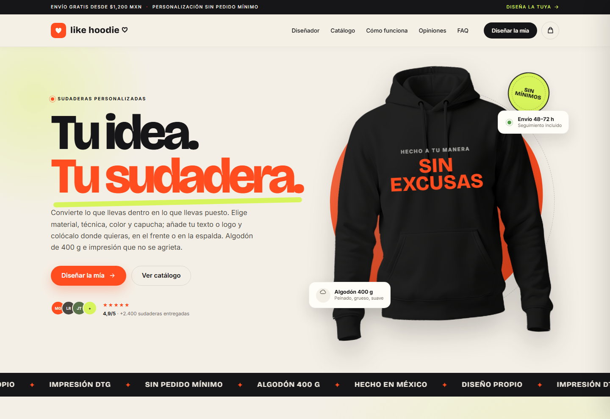
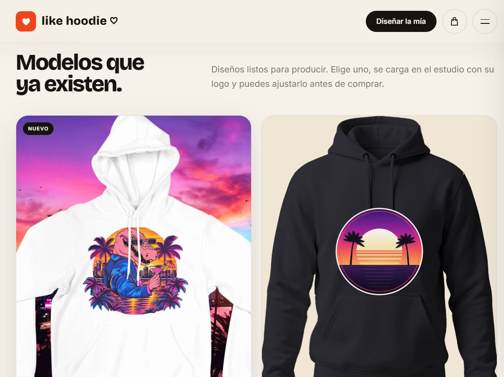
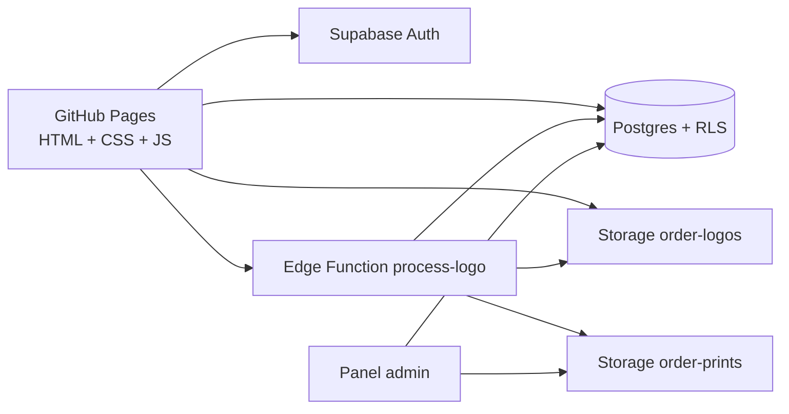

# like hoodie ♡ — Sudaderas personalizadas

[](https://likehoodie.com/)
[](https://github.com/celc91/like-hoodie/actions)
[-d8f45c?style=flat-square)](LICENSE)

Tienda online de demostración para vender sudaderas personalizadas. Incluye catálogo base, colección de modelos, editor tipo Canva, carrito persistente y checkout simulado. Todo con HTML, CSS y JavaScript sin dependencias ni proceso de build.

**Demo:** https://likehoodie.com/ · **Panel:** `/admin.html` (requiere usuario administrador)



## Contenido

- [Qué incluye](#qué-incluye)
- [Editor tipo Canva](#editor-tipo-canva)
- [Colección de modelos](#colección-de-modelos)
- [Capturas](#capturas)
- [Arquitectura](#arquitectura)
- [Archivo de impresión DTG](#archivo-de-impresión-dtg-automático)
- [Roadmap](#roadmap)
- [Contribuir](#contribuir-y-licencia)

## Qué incluye

- **Diseñador en vivo:** sudadera o tote bag, color, talla o medida, texto, tipografía, color de texto y subida de logo (PNG, JPG o WebP).
- **Editor tipo Canva:** barra superior fija (producto, frente/espalda, historial), rail de herramientas (Producto, Texto, Logo), lienzo central y panel de propiedades contextual.
- **Historial y atajos:** deshacer/rehacer, `Ctrl/Cmd+Z`, `Ctrl/Cmd+Shift+Z`, `Ctrl/Cmd+D`, flechas para mover y `Supr` para eliminar.
- **Barra flotante del elemento:** centrar en el área, copiar el texto a la otra cara y eliminar.
- **Productos:** sudadera de algodón en cinco materiales y tote bag de lona en tres, cada uno con su precio base, sus colores y sus técnicas.
- **Colores:** negro, blanco, crema, lima, naranja, marino y rosa.
- **Materiales:** algodón 400 g, algodón 320 g, French terry, mezcla 50/50 y poliéster técnico, con ajuste de precio y textura visual en el modelo.
- **Técnicas de personalización:** DTG, DTF, bordado, serigrafía, vinilo textil y sublimación, con costos, acabados visuales y avisos de compatibilidad.
- **Editor frontal y trasero:** cambia de vista, arrastra el texto y el logo, elige tipografía, ajusta su tamaño y personaliza cada cara por separado.
- **Galería de vistas:** frente y espalda con miniaturas; el diseño de cada cara se guarda por separado.
- **Precio dinámico:** base por color, material, técnica, suplemento de talla XXL y extra por logo en cada cara.
- **Catálogo base:** cuatro colores con selección directa al configurador.
- **Colección de modelos:** cuatro diseños listos (Cocodrilo de Miami, Insignia atardecer, Panorama Vice y Corazón neón) que se cargan en el editor con su logo y su color.
- **Carrito:** cantidades, eliminación, subtotal, envío y envío gratis desde $1,200 MXN.
- **Persistencia:** el carrito se guarda en `localStorage` y se sincroniza con Supabase.
- **Checkout de demostración:** formulario validado, confirmación de pedido y registro del pedido en Supabase. No procesa pagos reales.
- **Panel de administración:** pedidos, estados, carritos abandonados, métricas, embudo y exportación CSV, protegido con Supabase Auth.
- **Analítica propia:** eventos de visita, carrito y checkout guardados en Supabase.
- **Guía de tallas, FAQ, opiniones y newsletter.**
- **Páginas legales:** aviso de privacidad, política de cookies y términos y condiciones.
- **Aviso de cookies:** banner informativo con almacenamiento local para recordar la aceptación.
- **Vectorizador de logo:** convierte el PNG o JPG en SVG en el dispositivo, en color o a 1 tinta, con diagnóstico de colores, trazos y DPI.
- **Archivo de impresión DTG:** al subir el logo se recorta el fondo y se genera el PNG a 300 DPI en `order-prints`, con estado visible y descarga desde el admin.
- **Responsive:** móvil, tablet y escritorio.
- **Accesibilidad:** navegación por teclado, foco visible, etiquetas ARIA y respeto por `prefers-reduced-motion`.

## Editor tipo Canva

El estudio (`#personalizar`) se organiza como un editor, no como un formulario:

- **Barra superior:** fija bajo la cabecera del sitio, con producto, cara del diseño (Frente/Espalda), deshacer/rehacer, guías y estado en vivo.
- **Rail izquierdo:** Producto, Texto y Logo. El botón activo cambia el panel derecho.
- **Lienzo central:** prenda, cuadrícula de impresión, zoom y miniaturas de frente/espalda.
- **Panel derecho:** propiedades contextuales del elemento o del producto; al final, resumen, precio y **Añadir a la cesta**.
- **Barra flotante sobre el elemento:** centrar, copiar el texto a la otra cara y eliminar.
- **Guía de colocación plegable** con coordenadas y estado dentro/fuera del área.

Atajos:

| Atajo | Acción |
| --- | --- |
| `Ctrl/Cmd + Z` | Deshacer |
| `Ctrl/Cmd + Shift + Z` o `Ctrl/Cmd + Y` | Rehacer |
| `Ctrl/Cmd + D` | Copiar el texto a la otra cara |
| Flechas | Mover el elemento activo 0.5 % (con `Shift`, 2 %) |
| `Supr` / `Backspace` | Eliminar el elemento activo |

El historial (50 pasos) cubre el diseño: texto, logo, posición, escala, rotación, tipografía y color del texto. No revierte la configuración del producto (color de prenda, talla, material o técnica).

## Colección de modelos

La sección **`#modelos`** muestra diseños que ya existen. Cada tarjeta carga el modelo en el estudio con su producto, color y logo, y lanza el archivo de impresión DTG.

| Modelo | Prenda | Precio | Mockup | Logo |
| --- | --- | --- | --- | --- |
| Cocodrilo de Miami | Sudadera blanca | $1,048 | `assets/modelos/cocodrilo.webp` | `assets/modelos/cocodrilo-logo.png` |
| Insignia atardecer | Sudadera negra | $998 | `assets/modelos/insignia.webp` | `assets/modelos/insignia-logo.png` |
| Panorama Vice | Sudadera negra | $998 | `assets/modelos/panorama.webp` | `assets/modelos/panorama-logo.png` |
| Corazón neón | Sudadera negra | $998 | `assets/modelos/corazon.webp` | `assets/modelos/corazon-logo.png` |

Los logos de los modelos son PNG con transparencia. El del cocodrilo se recortó del arte original para que no imprima un fondo blanco.

### Añadir un modelo

1. Guarda el mockup en `assets/modelos/<id>.webp` (4:5, ~900 px de ancho).
2. Guarda el arte en `assets/modelos/<id>-logo.png` con transparencia y menos de 5 MB.
3. Añade una tarjeta en `index.html` dentro de `.collection-grid` con `data-model="<id>"`.
4. Añade la entrada en `MODELS` (final de `app.js`):

```js
MODELS.miModelo = {
  product: "hoodie",
  color: "#1c1c1f",
  colorName: "Negro",
  side: "front",
  logo: "assets/modelos/mi-modelo-logo.png",
  fileName: "mi-modelo.png",
};
```

Al pulsar la tarjeta se ejecuta `applyModel(id)`: ajusta producto/color/vista, descarga el logo, lo sube a Storage y arranca `process-logo`.

## Capturas



*La colección, con el Cocodrilo de Miami como primer modelo.*

## Arquitectura



- **Frontend:** estático, sin build. GitHub Pages sirve `index.html`, `admin.html` y los assets.
- **Auth:** Supabase con sesión anónima para el carrito y usuario administrador para el panel.
- **Datos:** Postgres con RLS para carritos, pedidos, eventos, cupones y `logo_assets`.
- **Storage:** `order-logos` (originales, privado) y `order-prints` (recorte y print, privado).
- **Edge Function:** `process-logo` procesa en dos etapas para caber en 256 MB / 2 s de CPU.
- **Admin:** lee pedidos y genera enlaces firmados de una hora para logos y prints.

## Vectorizado de logo (en el navegador)

El configurador incluye un prototipo de vectorización que corre en el dispositivo: el logo no se envía a ningún servidor.

- **Motor:** `vendor/imagetracer-1.2.6.js` (Unlicense) y `vectorize.js` (código propio).
- **Modos:** color (DTF/DTG) y 1 tinta (serigrafía/vinilo).
- **Proceso:** recorte de fondo, paleta propia, trazado y limpieza del SVG.
- **Diagnóstico:** colores, trazos, nodos, PPI de origen y avisos para fotos, degradados o ruido.
- **Salida:** se aplica al diseño (sustituye al PNG) o se descarga como `.svg`.

Es un prototipo: el SVG no se sube a Supabase. Para producción conviene mover el trazado a servidor (vtracer + potrace) y guardar el archivo en el bucket `order-logos`.

## Archivo de impresión DTG automático

Al subir un logo, el configurador crea un registro en `logo_assets` y la Edge
Function `process-logo` genera el PNG de producción en dos etapas (para no pasar
de 256 MB ni 2 s de CPU):

1. **cutout:** descarga el original, elimina el fondo uniforme, aplica
   `defringe` y guarda `order-prints/<user>/<asset>-cutout.png`.
2. **resize:** amplía al ancho de impresión con alfa premultiplicado y guarda
   `<asset>-print.png`.

El cliente muestra el estado (en cola, quitando fondo, ajustando resolución,
listo, revisión manual) y el panel de administración permite descargar el print
con su DPI. Si el archivo no está listo al pagar, el pedido guarda el
`logoAssetId` y el admin consulta el asset en vivo.

### Despliegue (una vez)

```sh
# 1. Crear tabla, bucket y políticas
#    Supabase → SQL Editor → pegar supabase/logo-assets.sql

# 2. Desplegar la función
npx supabase login
npx supabase functions deploy process-logo --remote=<tu-project-ref>
```

No hacen falta secretos extra: `SUPABASE_URL`, `SUPABASE_ANON_KEY` y
`SUPABASE_SERVICE_ROLE_KEY` los inyecta Supabase.

### Límites y decisiones

- Ancho de referencia: 24 cm frente, 28 cm espalda, 30 cm tote.
- Salida máxima: 2 800 px (≈254 DPI a 28 cm) y ampliación máxima 2×.
- Imágenes de más de 9 MP se rechazan con aviso.
- Si el DPI final es < 200 o el fondo no era uniforme, el asset queda en
  `review` en vez de `ready`.
- WebP se convierte a PNG en el navegador antes de subirlo.

## Ver la web en local

No necesita instalación. Abre directamente `index.html` en el navegador.

Si prefieres servirla con un servidor local:

```bash
npx serve .
```

O con Python:

```bash
python -m http.server 4173
```

## Publicar en GitHub Pages

1. Sube el proyecto a un repositorio de GitHub.
2. Entra en **Settings → Pages**.
3. En **Build and deployment**, selecciona **Deploy from a branch**.
4. Elige la rama `main`, carpeta `/ (root)` y guarda.
5. El sitio se publica en `https://likehoodie.com/`.

El archivo `CNAME` ya contiene el dominio personalizado. En el proveedor de DNS (Cloudflare) deben existir estos registros, sin proxy:

- `A @` → `185.199.108.153`, `185.199.109.153`, `185.199.110.153`, `185.199.111.153`.
- `CNAME www` → `celc91.github.io`.

Cuando GitHub verifique el dominio y emita el certificado, activa **Enforce HTTPS** en **Settings → Pages**.

## Pedidos y administración

La tienda guarda carritos, pedidos y eventos en **Supabase**. El panel está en `admin.html` y requiere iniciar sesión con un usuario administrador.

Para configurarlo:

1. Sigue los pasos de [`supabase/README.md`](supabase/README.md).
2. Pega la URL y la publishable key del proyecto en `supabase-config.js`.
3. Publica los cambios en GitHub Pages.

Mientras `supabase-config.js` tenga los valores de ejemplo, la tienda funciona en modo demostración y el panel muestra un aviso de configuración.

## Medición y consentimiento

Google Analytics y Meta (Pixel y Conversions API) se cargan solo con permiso explícito, y analítica y publicidad son permisos independientes: se puede aceptar uno, otro, los dos o ninguno. El detalle completo —decisiones, eventos, cómo verificarlo y cómo rotar el token— está en [`MEDICION.md`](MEDICION.md).

## Calendario de conciertos

La sección **Eventos** (`#eventos`) es una fuente de inspiración: muestra los próximos conciertos en México para que cada persona imagine y diseñe su sudadera con el artista, la ciudad o la fecha. Cada evento tiene un botón **Diseñar** que lleva al personalizador con un texto sugerido, y un enlace secundario para comprar boletos en **Ticketmaster México**.

Los datos viven en `eventos.json`. Es una fotografía de la cartelera, así que los horarios, recintos y disponibilidad pueden cambiar; confirma siempre en Ticketmaster antes de comprar. like hoodie ♡ no vende boletos ni participa en esa transacción.

Para actualizar la cartelera con la API oficial:

1. Crea una API key gratuita en [developer.ticketmaster.com](https://developer.ticketmaster.com/).
2. Ejecuta el sincronizador:

```powershell
$env:TICKETMASTER_API_KEY = "TU_API_KEY"
node scripts/sync-ticketmaster.mjs
```

El script consulta la **Discovery API** para México, filtra eventos musicales y reescribe `eventos.json`. La API key solo se usa en la computadora o en CI; nunca se incluye en el sitio publicado.

## Correo

`hola@likehoodie.com` recibe correos mediante **Cloudflare Email Routing** y los reenvía a la cuenta de Gmail del administrador. Cloudflare administra los registros MX y SPF del dominio.

Los correos automáticos de pedido se envían con **Resend** desde `hola@likehoodie.com`. La API key se guarda en **Supabase Vault** con el nombre `resend_api_key` y un trigger sobre `orders` envía:

- Confirmación al cliente.
- Aviso al administrador.

La configuración está en `supabase/email-notifications.sql`.

## Pagos con Clip

La integración con **Clip Checkout redireccionado** está creada en `supabase/functions/`:

- `clip-checkout`: valida la sesión, lee el total autoritativo del pedido y crea el link de pago.
- `clip-webhook`: recibe el aviso de Clip, consulta el estado real y marca el pedido como pagado.

Está **desactivada por defecto**. Mientras `store_settings.clip_enabled = 'false'`, el checkout sigue siendo una demostración y no se crea ningún cargo.

### Activar

1. Ejecuta `supabase/clip-payments.sql` en Supabase → SQL Editor.
2. Instala la CLI y vincula el proyecto:

   ```powershell
   npx supabase login
   npx supabase link --project-ref qrblsclpzoaxfaggsrda
   ```

3. Configura los secretos. No los pongas en el repositorio:

   ```powershell
   npx supabase secrets set CLIP_API_KEY=... CLIP_API_SECRET=... CLIP_WEBHOOK_SECRET=... SITE_URL=https://likehoodie.com
   ```

   `CLIP_WEBHOOK_SECRET` debe ser una cadena aleatoria larga. El webhook queda en:

   `https://qrblsclpzoaxfaggsrda.supabase.co/functions/v1/clip-webhook?secret=...`

4. Despliega las funciones:

   ```powershell
   npx supabase functions deploy clip-checkout
   npx supabase functions deploy clip-webhook
   ```

5. Activa el cobro:

   ```sql
   update public.store_settings
      set value = 'true', updated_at = now()
    where key = 'clip_enabled';
   ```

6. Haz un pedido de prueba. Clip debe mostrar su página de pago y, al completar, el pedido debe aparecer como **Pagado** en el panel.

### Simulador de pagos (sandbox)

Clip **no tiene sandbox para Checkout redireccionado** (links de pago): su modo de prueba solo cubre Checkout Transparente y Reembolsos, con credenciales `test_` y las tarjetas publicadas en `developer.clip.mx/reference/pruebas`. Como esta tienda usa el checkout redireccionado, la web incluye un **simulador** del paso de pago con esas tarjetas oficiales:

- Abre el checkout con `?sandbox=1` (en `localhost` se activa solo).
- Elige una tarjeta de prueba y confirma: verás el estado **Aprobado** o **Rechazado** con el motivo.
- No se realiza ningún cargo real y el pedido queda registrado como demostración.

Tarjetas incluidas en el simulador:

| Tarjeta | PAN | Resultado |
| --- | --- | --- |
| Visa | 4766944332216006 | Aprobado |
| Mastercard | 5215956400364553 | Aprobado |
| Amex | 377770358335399 | Aprobado |
| Amex | 377770541774520 | Rechazado: fondos insuficientes |
| Visa | 4208312218017433 | Rechazado: fondos insuficientes |
| Amex | 377770520127013 | Rechazado: no autorizada |

El simulador se oculta automáticamente cuando `payment_provider = 'clip'`, para no mezclarlo con cobros reales. La lógica está en `app.js` (`CLIP_TEST_CARDS` y `updateSandboxUI`) y el panel en `index.html` (`data-sandbox-pay`).

### Sandbox real con Checkout Transparente

Además del simulador, la web puede cobrar de verdad contra el **sandbox de Clip** usando el SDK de Checkout Transparente:

1. Crea credenciales de prueba en el Panel de Desarrollador de Clip y copia la **API Key** (empieza con `test_`).
2. Pega la clave en `clip-config.js`:

   ```js
   window.LIKEHOODIE_CLIP = { publicKey: "test_..." };
   ```

3. Configura los secretos de Supabase y despliega la función:

   ```powershell
   npx supabase secrets set CLIP_API_KEY=test_...
   npx supabase functions deploy clip-pay
   ```

4. Abre el checkout con `?sandbox=1`, escribe los datos de envío y paga con una de las tarjetas de prueba. El SDK monta el formulario de tarjeta de Clip; el token se cobra en el servidor con `POST /payments`.

La función `clip-pay` **solo acepta claves `test_`** (para evitar cobros reales por error). Si algún día quieres usarla con producción, añade `CLIP_ALLOW_LIVE=1` y la clave real.

> Si `clip-config.js` está vacío o el SDK no carga, la web vuelve automáticamente al simulador local de tarjetas.

**Nota de seguridad:** la API Key del SDK es pública por diseño (Clip la usa en su iframe). La clave secreta (`CLIP_API_SECRET`) y el webhook siguen siendo privados y viven solo en los secrets de Supabase.

### Volver a demostración

```sql
update public.store_settings
   set value = 'false', updated_at = now()
 where key = 'clip_enabled';
```

### Seguridad

- Las credenciales de Clip viven en los secrets de Supabase, nunca en el navegador.
- El monto se toma de `orders.total`; el navegador no puede cambiarlo.
- El webhook no confía en el cuerpo: consulta `GET /v2/checkout/{id}`.
- Los enlaces de pago se reutilizan mientras estén activos para evitar cobros duplicados.
- Un webhook repetido no vuelve a marcar el pedido ni duplica los correos.

## Logos de pedidos

Los archivos de logo se suben al bucket privado **`order-logos`** de Supabase Storage. Se aceptan PNG, JPG y WebP de hasta 5 MB. El panel de administración genera enlaces firmados de una hora para verlos o descargarlos desde el detalle de cada pedido.

Los derivados de producción (recorte y print) se guardan en **`order-prints`**, también privado. El admin descarga el print final con su DPI desde el pedido; el recorte se conserva para poder reprocesar sin volver a subir el original.

La configuración de ambos buckets y sus políticas RLS está en `supabase/storage-logos.sql` y `supabase/logo-assets.sql`.

## Seguridad

- `supabase/security-hardening.sql` valida precios en el servidor, limita pedidos por usuario/correo, restringe permisos de funciones y permite borrar los logos propios.
- `supabase/storage-logos.sql` define el bucket privado y sus políticas.
- `supabase/email-notifications.sql` envía los correos de pedido con Resend.
- `supabase/clip-payments.sql` prepara los estados de pago y la configuración de Clip.
- `supabase/logo-assets.sql` crea la tabla `logo_assets`, el bucket privado `order-prints` y sus políticas.
- `supabase/functions/` contiene las Edge Functions de Clip y `process-logo`.
- `vendor/supabase-js.min.js` fija Supabase JS 2.119.0 en local para evitar dependencias flotantes de CDN.
- `vendor/imagetracer-1.2.6.js` fija el motor de vectorización en el navegador.

Después de un despliegue limpio, ejecuta en orden: `schema.sql`, `storage-logos.sql`, `security-hardening.sql`, `logo-assets.sql`, `clip-payments.sql` y `email-notifications.sql`. Después despliega `process-logo` (ver “Archivo de impresión DTG automático”).

## Estructura

```text
.
├── index.html        # Contenido y estructura
├── styles.css        # Diseño, responsive y animaciones
├── app.js            # Configurador, editor, modelos, carrito, checkout y modales
├── vectorize.js      # Vectorizador de logos en el navegador
├── eventos.js        # Calendario de conciertos
├── eventos.json      # Cartelera de Ticketmaster México
├── store-supabase.js # Sincronización de carritos, pedidos y eventos
├── supabase-config.js# URL y publishable key de Supabase
├── admin.html        # Panel de administración
├── admin.js          # Lógica del panel
├── admin.css         # Diseño del panel
├── supabase/         # Esquema SQL, políticas y Edge Functions (Clip y process-logo)
├── scripts/          # Sincronización de la cartelera de eventos
├── legal.js          # Aviso de cookies y almacenamiento local
├── privacidad.html   # Aviso de privacidad
├── cookies.html      # Política de cookies
├── terminos.html     # Términos y condiciones
├── assets/           # Fotos de producto, máscaras y modelos de la colección
├── vendor/           # Supabase JS e ImageTracer fijados localmente
├── docs/             # Capturas para la documentación
├── .github/          # Plantillas de issue/PR y workflows
├── preview.png       # Captura para el README
├── 404.html          # Página de error
├── CONTRIBUTING.md   # Cómo contribuir
├── SECURITY.md       # Reporte de vulnerabilidades
├── CHANGELOG.md      # Historial de versiones
├── LICENSE           # MIT para el código
├── ASSETS-LICENSE.md # Marca y assets reservados
└── README.md
```

## Personalización rápida

- **Colores de marca:** variables en `:root` dentro de `styles.css` (`--orange`, `--lime`, `--cream`, `--ink`).
- **Precios:** constantes y mapa `BASE_PRICES` al inicio de `app.js`. El blanco (`#ffffff`) cuesta $949 en sudadera y $379 en tote.
- **Envío gratis:** `FREE_SHIPPING` en `app.js` (por defecto $1,200 MXN).
- **Coste de envío:** `SHIPPING_COST` en `app.js`.
- **Productos del catálogo base:** tarjetas en `index.html` y sus botones `data-personalize`.
- **Modelos de la colección:** tarjetas `data-model` en `index.html` y el objeto `MODELS` al final de `app.js`.
- **Editor:** el layout tipo Canva vive al final de `styles.css` (bloque “Editor tipo Canva — Fase 1”) y la lógica de historial/atajos en `app.js`.
- **Barra fija:** `--site-header-h` se mide en `app.js`; si cambias la altura del header, la barra se ajusta sola.

## Fotografías de producto

El editor usa una maqueta fotográfica frontal y trasera con fondo transparente, extraída de una plantilla de **Mockup Space** (licencia free personal & commercial use). Puedes sustituir `assets/hoodie-front.png` y `assets/hoodie-back.png` por fotografías reales de tus sudaderas manteniendo el fondo transparente y una composición vertical similar. Los colores se aplican con capas de tinte y máscaras, así que las fotos nuevas deben ser claras y con buena iluminación.

## Roadmap

- [x] Editor tipo Canva: layout, historial, atajos y barra flotante.
- [x] Colección de modelos y color blanco.
- [x] Archivo de impresión DTG automático en dos etapas.
- [x] Barra superior fija al hacer scroll.
- [ ] Capas y bloqueo de elementos.
- [ ] Copiar el logo a la otra cara con un asset nuevo.
- [ ] Plantillas de diseño dentro del editor.
- [ ] Integración con Canva Connect para importar diseños.

## Limitaciones conocidas

- El checkout sigue en **modo demostración**; Clip está preparado y desactivado.
- El print DTG se limita a 2 800 px (≈254 DPI a 28 cm) y 2× de ampliación.
- El vectorizador trabaja en el navegador; no guarda el SVG en Supabase y no es fiel en fotos o degradados.
- Los precios de las tarjetas de la colección están fijados en el HTML; si cambia la base, hay que actualizarlos.
- Los modelos se cargan subiendo de nuevo su logo, así que cada uso crea un asset nuevo.

## Contribuir y licencia

- Guía de contribución: [`CONTRIBUTING.md`](CONTRIBUTING.md).
- Seguridad: [`SECURITY.md`](SECURITY.md). No abras issues públicos para vulnerabilidades.
- Historial de cambios: [`CHANGELOG.md`](CHANGELOG.md).
- Código bajo **MIT** ([`LICENSE`](LICENSE)); marca, fotos y diseños reservados ([`ASSETS-LICENSE.md`](ASSETS-LICENSE.md)).
- CI en [`.github/workflows`](.github/workflows): enlaces, HTML y Lighthouse. Los dos primeros corren en cada push a `main`; Lighthouse se lanza a mano desde Actions.

## Antes de publicar la tienda real

- Completa los datos marcados con `[completar]` en `privacidad.html` y `terminos.html`: razón social, RFC, domicilio fiscal y ciudad de jurisdicción.
- Revisa los documentos legales con un abogado antes de operar comercialmente.
- Revoca los tokens de publicación que ya no uses y rota la contraseña del administrador.
- Comprueba que el repositorio no contiene credenciales, datos de clientes ni capturas con información personal.
- Configura Supabase (`supabase/README.md`), crea el usuario administrador y pega la URL y la publishable key en `supabase-config.js`.
- Completa el KYC de Clip, configura sus credenciales y activa `clip_enabled` cuando quieras cobrar de verdad.
- Actualiza el aviso de privacidad y los términos cuando conectes pagos reales, newsletter o envíos.
- Si añades cookies de analítica o publicidad, actualiza `cookies.html` y pide consentimiento.

## Nota

El checkout sigue en modo demostración: valida los datos, registra el pedido y muestra una confirmación, pero no realiza ningún cargo. La integración con **Clip** ya está preparada y desactivada; se activa con `store_settings.clip_enabled = 'true'` después de configurar las credenciales y desplegar las Edge Functions. Los precios se validan en el servidor, los logos se guardan en un bucket privado de Supabase Storage y el panel genera enlaces firmados para verlos o descargarlos.
